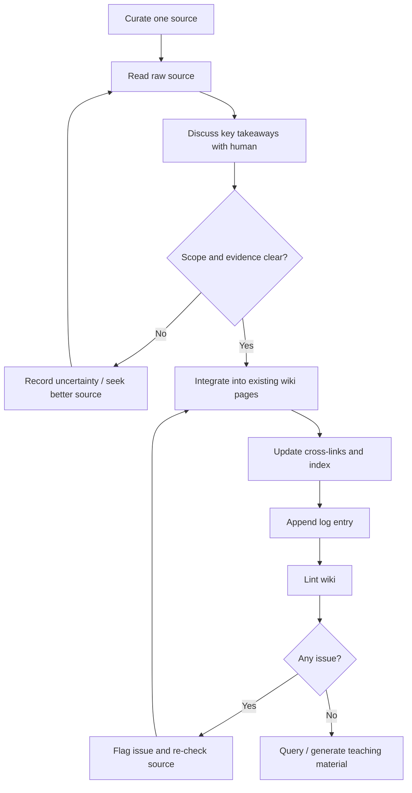

# Workflow：Ingest → Query → Lint → Update

## Graph

## Repeated steps

- Read and discuss repeats for each newly ingested source.
- Integration may touch multiple existing pages.
- Lint repeats after each meaningful update and periodically as the wiki grows.

## Checks and rework

- Before integration: verify source identity, scope, date and evidence.
- After integration: verify citations, cross-links, contradictions and index.
- Before presentation: check each slide's claim against wiki pages and source IDs.

## Why this design?

It follows the Karpathy idea file: the raw collection remains the source of truth; the wiki is a persistent, incrementally maintained synthesis; schema guides consistent operations; index and log support navigation and history. One-source-at-a-time ingest preserves human involvement and makes provenance errors easier to catch.

## First-run reflection template

- Most error-prone node:
- What was wrong:
- Where the check was moved earlier:
- Workflow/graph change:
- Evidence (chat transcript, before/after file, lint report):
